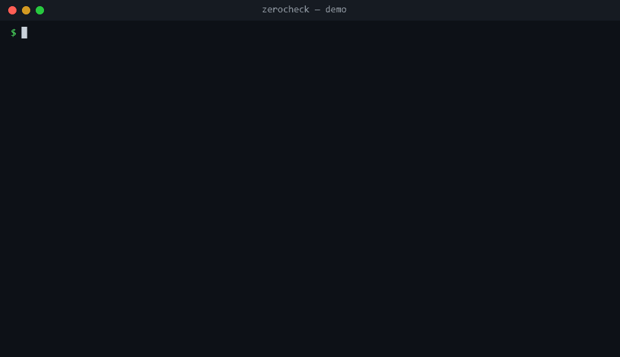

# ZeroCheck

[](https://github.com/AliAlassaf/zerocheck/actions/workflows/ci.yml)   

**Zero results ≠ zero activity.** ZeroCheck tells an analyst, or an AI SOC agent, whether an empty SIEM search is a *verified negative* or a *blind spot*.



```
$ zerocheck verify -q process_execution -e WS-02 --start 2026-10-06T01:00Z --end 2026-10-06T05:00Z -m process.name=mimikatz.exe

INSUFFICIENT VISIBILITY — zero results here do NOT mean it didn't happen
  question : process_execution on WS-02
  window   : 2026-10-06 01:00 -> 2026-10-06 05:00 UTC
  match    : {'process.name': 'mimikatz.exe'}  ->  0 event(s)
  coverage : 62% of the window observable
  blind    : 10-06 02:00-03:30
    - [source_silent] security_4688 10-06 02:00-03:30: WS-02 sent no security_4688 events for longer than 30m
    - [source_silent] sysmon_process_create 10-06 02:00-03:30: WS-02 sent no sysmon_process_create events for longer than 30m
  next steps:
    * Check agent/sensor health on the entity for that interval; pull local logs or EDR telemetry from the host directly if it is still available.
```

## The problem

A Tier 1 analyst searches for `mimikatz.exe` on a host, gets nothing, and closes the case. But the search came back empty because the EDR agent had crashed for 90 minutes, because a parser update emptied `process.command_line`, because the pipeline was 40 minutes behind, or because the data had already aged out. Nobody finds out until Tier 3 does.

AI SOC agents make this worse: they run most of the queries now, and an agent that gets `[]` back has no reason to doubt it.

## What it does

For one **investigative question** (for example, *did this process run on this host?*), one **entity** and one **time window**, ZeroCheck runs the search and also checks whether the telemetry needed to answer it was actually there:

| Check | Catches |
|---|---|
| Per-entity silence | The entity sent nothing from a source for longer than that source's normal silence (agent crash, host isolated, audit policy off) |
| Ingestion watermark | The newest ingested event is older than the window end (pipeline lag) |
| Retention boundary | The window starts before the oldest stored event |
| Field fill rate | Events exist, but the fields you search on (or the source's required fields) are mostly empty (parser or schema drift) |
| Source presence | The event type has never been collected at all |
| Access | The querying identity cannot read the source |

Sources are **alternatives**: if Sysmon was down but Security 4688 covered the same minutes, the window is still observable. It returns one of three verdicts:

- **`FOUND`**: matching evidence exists.
- **`VERIFIED_NEGATIVE`**: no matches, and every minute of the window was observable by at least one healthy source.
- **`INSUFFICIENT_VISIBILITY`**: no matches, and some of the window was blind. It lists the blind intervals, the reason for each, and what to do next.

## How it differs from existing tools

| Tool | Unit of analysis | Question it answers |
|---|---|---|
| [deadair](https://pkg.go.dev/github.com/alephnull-sh/deadair) | Detection rule | "Which of my enabled rules are blind?" |
| [DeTT&CT](https://github.com/rabobank-cdc/DeTTECT) | ATT&CK technique | "Where is my visibility weak, strategically?" |
| SIEM health dashboards | Connector / data source | "Is this feed up?" |
| **ZeroCheck** | **One search on one entity and time window, during an investigation** | **"Can I trust *this* zero?"** |

These tools complement each other. deadair tells you which rules are blind; ZeroCheck tells you which conclusions are blind.

## Quick start

```bash
pip install -e '.[mcp,dev]'

zerocheck demo        # six scenarios: found, real negative, sensor outage, parser drift, ingestion lag, retention
zerocheck questions   # list the built-in investigative questions
```

### Against Elasticsearch / Elastic Security

```bash
export ZEROCHECK_ES_URL=https://localhost:9200
export ZEROCHECK_ES_API_KEY=...            # or ZEROCHECK_ES_USERNAME / ZEROCHECK_ES_PASSWORD
zerocheck verify -q user_logon -e DC01 --start 2026-10-06T00:00Z --end 2026-10-06T06:00Z -m user.name=svc_backup
```

The exit code is `0` for FOUND or VERIFIED_NEGATIVE and `3` for INSUFFICIENT_VISIBILITY, so it can gate a playbook step. Add `--json` for machine-readable output.

### Through Kibana only (for example, TryHackMe labs)

Many labs expose Kibana but not Elasticsearch's port 9200. Point ZeroCheck at Kibana and it sends the same queries through Kibana's console proxy (the one Dev Tools uses), with the same username and password you use to log in:

```bash
export ZEROCHECK_KIBANA_URL=http://MACHINE_IP          # the address you open Kibana with
export ZEROCHECK_ES_USERNAME=... ZEROCHECK_ES_PASSWORD=...
zerocheck --catalog examples/catalogs/winlogbeat.yaml verify -q process_execution -e HOST --start ... --end ... -m process.name=...
```

[`examples/catalogs/winlogbeat.yaml`](examples/catalogs/winlogbeat.yaml) maps the questions to Winlogbeat's `winlogbeat-*` indices, where channels are told apart by `winlog.channel`.

To try it on a local cluster:

```bash
docker run -d -p 9200:9200 -e discovery.type=single-node -e xpack.security.enabled=false elasticsearch:8.15.3
python scripts/load_demo_into_elastic.py
ZEROCHECK_ES_URL=http://localhost:9200 pytest tests/test_elastic_integration.py
```

### As an MCP server for AI SOC agents

```json
{
  "mcpServers": {
    "zerocheck": {
      "command": "zerocheck-mcp",
      "env": { "ZEROCHECK_ES_URL": "https://localhost:9200", "ZEROCHECK_ES_API_KEY": "..." }
    }
  }
}
```

The server exposes `list_questions` and `verify_search`. Its instructions tell the agent that only `VERIFIED_NEGATIVE` supports concluding that something did not happen.

## Question catalog

Questions are YAML. The built-ins in [`src/zerocheck/catalog/windows.yaml`](src/zerocheck/catalog/windows.yaml) cover process execution, network connections, DNS, logons, PowerShell script blocks and scheduled task creation, using Elastic Agent data stream names. To add your own or override them, pass `--catalog my_questions.yaml`:

```yaml
- id: process_execution
  description: Did a given process run on a host?
  entity_field: host.name
  match_fields: [process.name, process.command_line, user.name]
  sources:
    - name: sysmon_process_create
      index: logs-windows.sysmon_operational-*
      filter: {event.code: "1"}
      required_fields: [process.name, process.command_line]
      max_silence: 30m          # longer silence from a host = blind
    - name: security_4688
      index: logs-system.security-*
      filter: {event.code: "4688"}
      required_fields: [process.name]
      max_silence: 30m
```

For rare events (such as 4698 task creation), the event's own silence proves nothing. Set `liveness_filter` to judge liveness from the whole channel instead.

## Evaluation

ZeroCheck was tested on 14 real attack recordings from [OTRF Security-Datasets](https://github.com/OTRF/Security-Datasets) (credential dumping, LOLBins, discovery, scheduled tasks), with six visibility failures injected so that a plain search for the attack returns zero results. Treating that zero as "didn't happen" misses all 84 blind spots.

- **Parser drift, logging disabled, access denied and retention:** 56/56 detected, with no false warnings on clean data.
- **Ingestion lag:** 13/14 detected. The miss sat inside the lag tolerance.
- **Sensor outages:** this is the weak spot. A fixed silence threshold either catches every outage and raises false warnings on 43–64% of clean recordings, or raises none and catches 8 of 14. Per-host baselines are the next step.

Method, findings and limitations (the recordings are seconds long, so thresholds were scaled to seconds) are in [evaluation/README.md](evaluation/README.md). Full numbers are in [evaluation/RESULTS.md](evaluation/RESULTS.md). To reproduce, run `python evaluation/run.py`.

## Limitations (v0.1)

- `max_silence` is configured per source, not learned from each host's baseline yet. A host that is legitimately idle overnight can trigger a false `source_silent` warning.
- An audit policy disabled on *one* host, while its channel stays alive, is not detected. A policy disabled everywhere shows up as `source_empty`.
- Field drift is judged across the whole window, not per minute.
- Matching uses exact values (case-insensitive). Wildcards and free text are not supported yet.
- Elastic is the only SIEM backend so far (directly or through Kibana).

## Roadmap

- [x] Evaluation harness on [OTRF Security-Datasets](https://github.com/OTRF/Security-Datasets) with injected visibility failures ([results](evaluation/RESULTS.md))
- [ ] Per-host silence baselines in place of fixed `max_silence` (the evaluation's main finding)
- [ ] Evaluation on longer recordings and more question types
- [ ] Microsoft Sentinel (KQL) backend
- [ ] Raw-vs-parsed replay checks for schema mappings
- [ ] Optional LLM step that maps a free-text analyst question to a catalog question

## Development

```bash
pytest                    # unit tests, plus Elastic integration tests when ZEROCHECK_ES_URL is set
```

Licensed under Apache 2.0.
